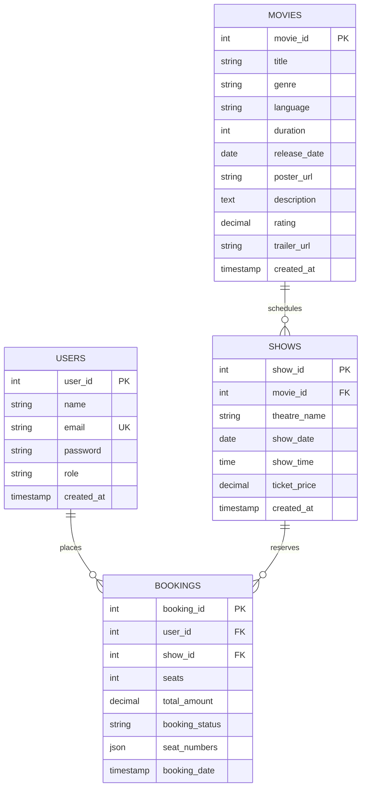

# IRSHAD CINEMAS — Online Movie Ticket Booking System

[](https://nodejs.org/)
[](https://expressjs.com/)
[](https://www.mysql.com/)
[](#security-architecture)
[](#project-information)

> **A modern, commercial-grade Online Movie Ticket Booking platform built with HTML5, CSS3, Vanilla JavaScript, Node.js, Express.js REST APIs, and a relational MySQL database featuring atomic seat reservation transactions.**

---

## 📌 Project Information

- **Project Title:** Online Movie Ticket Booking System
- **Platform Name:** IRSHAD CINEMAS
- **Project Owner / Lead Developer:** **Shaik Irshad**
- **Academic Context:** College Mini-Project (Full-Stack Production Quality)
- **Repository Architecture:** Monorepo with Model-View-Controller & REST API separation

---

## 🌟 Executive Summary & Features

**IRSHAD CINEMAS** replicates the seamless booking flows of commercial platforms like BookMyShow and PVR INOX, wrapped in an original **Dark Cinematic Theme** (`#0B0B0F`, `#17171F`, `#E50914`, `#D4AF37`).

### 👤 Customer Experience
- **Cinematic Homepage:** Large featured blockbuster banners, trailer previews, quick booking shortcuts, and curated categories (*Now Showing*, *Highest Rated*, *Coming Soon*).
- **Comprehensive Movie Catalog:** Real-time search with debounced querying, multi-genre filtering (*Action, Sci-Fi, Biography, Drama, Animation, Thriller*), language filtering, and sorting (*Rating, Release Date, Title, Runtime*).
- **Rich Movie Details:** High-resolution posters, synopsis, certification, runtime, YouTube trailer modal, and interactive multi-day date selector.
- **Theatre & Showtime Discovery:** Browse cinema screens (*PVR INOX Gold Class*, *IMAX Forum South*, *Cinepolis VIP*, *Miraj Cinemas*) with tiered ticket pricing.
- **Interactive Cinema Seat Matrix:**
  - Real-time seat grid categorized by rows (A through H) with screen orientation indicator.
  - Distinct state coloring: 🟢 **Available (Green)**, 🟡 **Selected (Yellow)**, 🔴 **Booked (Red)**.
  - Multi-seat selection (up to 10 seats per booking) with dynamic subtotal, GST calculation, and instant breakdown.
- **Atomic Booking Engine:** Backed by MySQL `START TRANSACTION`, `FOR UPDATE` row locking, and conflict detection to mathematically prevent double-booking.
- **Customer Booking History & M-Tickets:** Review past reservations and open a digital e-ticket modal complete with scannable barcode and instant print capability.

### 🛡️ Administrator Operations
- **Role-Based Security:** Strict RBAC separating customers from system administrators.
- **Real-Time Analytics Dashboard:** Instant metrics covering total movies, shows, registered users, confirmed bookings, and gross platform revenue.
- **Movie Catalog Management:** Full CRUD (Create, Read, Update, Delete) for films with image URLs, metadata, and ratings.
- **Show Scheduling Engine:** Schedule screenings across multiple venues, update timings, and modify ticket prices dynamically.
- **Booking Management:** Audit every customer transaction and toggle reservation status (*Confirmed*, *Cancelled*, *Completed*).
- **User Registry:** Inspect registered customer accounts, registration dates, and cumulative platform spend.

---

## 💻 Technology Stack

| Layer | Technologies Used |
| :--- | :--- |
| **Frontend** | HTML5 (Semantic), CSS3 (Custom Dark Cinematic Design System, Glassmorphism), Vanilla JavaScript (ES6+), Fetch API |
| **Icons & Typography** | Google Fonts (`Poppins`), FontAwesome 6.5.1 |
| **Backend Runtime** | Node.js v20+ / v24+, Express.js 4.x REST APIs |
| **Database** | MySQL 8.0+ Community Server / MySQL Workbench |
| **DB Driver** | `mysql2/promise` with Connection Pooling (15 connections) |
| **Security & Auth** | `bcryptjs` (Salt 10 rounds), `jsonwebtoken` (JWT 7-day tokens), `helmet` (CSP & Security Headers), `express-rate-limit` (Brute-force protection), `cors` |
| **Environment Config** | `dotenv` for secure credential separation |

---

## 🗄️ Database Architecture

The database strictly abides by the **FOUR REQUIRED CORE TABLES** with zero bloat, enforcing referential integrity and cascading rules.



### Table 1: `users`
Stores authenticated user accounts.
- `user_id` (INT PK AUTO_INCREMENT)
- `name` (VARCHAR(100) NOT NULL)
- `email` (VARCHAR(100) UNIQUE NOT NULL)
- `password` (VARCHAR(255) NOT NULL, bcrypt hashed)
- `role` (VARCHAR(20) NOT NULL DEFAULT 'customer', values: `'customer'`, `'admin'`)
- `created_at` (TIMESTAMP DEFAULT CURRENT_TIMESTAMP)

### Table 2: `movies`
Stores the film catalog with descriptive and aesthetic metadata.
- `movie_id` (INT PK AUTO_INCREMENT)
- `title` (VARCHAR(150) NOT NULL)
- `genre` (VARCHAR(50) NOT NULL)
- `language` (VARCHAR(30) NOT NULL)
- `duration` (INT NOT NULL, minutes)
- `release_date` (DATE NOT NULL)
- `poster_url` (VARCHAR(500) NULL)
- `description` (TEXT NULL)
- `rating` (DECIMAL(3,1) DEFAULT 8.5)
- `trailer_url` (VARCHAR(500) NULL)

### Table 3: `shows`
Stores scheduled screenings in local theatres.
- `show_id` (INT PK AUTO_INCREMENT)
- `movie_id` (INT NOT NULL, FK references `movies.movie_id` ON DELETE CASCADE ON UPDATE CASCADE)
- `theatre_name` (VARCHAR(100) NOT NULL)
- `show_date` (DATE NOT NULL)
- `show_time` (TIME NOT NULL)
- `ticket_price` (DECIMAL(10,2) NOT NULL)

### Table 4: `bookings`
Stores confirmed customer reservations.
- `booking_id` (INT PK AUTO_INCREMENT)
- `user_id` (INT NOT NULL, FK references `users.user_id` ON DELETE CASCADE ON UPDATE CASCADE)
- `show_id` (INT NOT NULL, FK references `shows.show_id` ON DELETE CASCADE ON UPDATE CASCADE)
- `seats` (INT NOT NULL, total count)
- `total_amount` (DECIMAL(10,2) NOT NULL)
- `booking_status` (VARCHAR(30) NOT NULL DEFAULT 'Confirmed')
- `seat_numbers` (JSON NOT NULL, e.g. `["A1", "A2"]`)
- `booking_date` (TIMESTAMP DEFAULT CURRENT_TIMESTAMP)

---

## 🔒 Concurrency & Transaction Management

To prevent **race conditions** when two customers simultaneously click and reserve the exact same seat:

```javascript
// Step 1: Start atomic transaction
await connection.beginTransaction();

// Step 2: Lock the show record to guarantee ticket pricing integrity
const [shows] = await connection.query(
    'SELECT * FROM shows WHERE show_id = ? FOR UPDATE', [show_id]
);

// Step 3: Fetch existing confirmed bookings with exclusive lock
const [existing] = await connection.query(
    "SELECT seat_numbers FROM bookings WHERE show_id = ? AND booking_status = 'Confirmed' FOR UPDATE",
    [show_id]
);

// Step 4: Collision detection
const conflicts = requestedSeats.filter(seat => bookedSet.has(seat));
if (conflicts.length > 0) {
    await connection.rollback();
    return res.status(409).json({ 
        success: false, 
        message: 'Seats already reserved.', 
        conflicting_seats: conflicts 
    });
}

// Step 5: Insert booking and commit atomically
await connection.query('INSERT INTO bookings ...', [...]);
await connection.commit();
```

---

## 🌐 REST API Specification

### Authentication APIs (`/api/auth`)
| Method | Endpoint | Auth Required | Description |
| :--- | :--- | :--- | :--- |
| `POST` | `/api/auth/register` | Public | Create new customer account |
| `POST` | `/api/auth/login` | Public | Authenticate user and issue JWT |
| `POST` | `/api/auth/logout` | Public | Invalidate client session |
| `GET` | `/api/auth/me` | Bearer Token | Retrieve authenticated user profile |

### Movies APIs (`/api/movies`)
| Method | Endpoint | Auth Required | Description |
| :--- | :--- | :--- | :--- |
| `GET` | `/api/movies` | Public | List movies with search, genre, language & sort |
| `GET` | `/api/movies/:id` | Public | Get movie details and upcoming showtimes |
| `GET` | `/api/movies/:id/shows` | Public | Retrieve shows for a specific movie |
| `POST` | `/api/movies` | Admin Only | Add a new film to catalog |
| `PUT` | `/api/movies/:id` | Admin Only | Update movie details |
| `DELETE` | `/api/movies/:id` | Admin Only | Remove movie from database |

### Shows APIs (`/api/shows`)
| Method | Endpoint | Auth Required | Description |
| :--- | :--- | :--- | :--- |
| `GET` | `/api/shows` | Public | List all scheduled shows with filters |
| `GET` | `/api/shows/:id` | Public | Get single show metadata |
| `GET` | `/api/shows/:id/seats` | Public | Live occupied seat matrix for show |
| `POST` | `/api/shows` | Admin Only | Schedule a new show |
| `PUT` | `/api/shows/:id` | Admin Only | Update show timing or ticket price |
| `DELETE` | `/api/shows/:id` | Admin Only | Cancel and delete scheduled show |

### Bookings APIs (`/api/bookings`)
| Method | Endpoint | Auth Required | Description |
| :--- | :--- | :--- | :--- |
| `POST` | `/api/bookings` | Customer / Admin | Book seats with database transaction |
| `GET` | `/api/bookings/my` | Customer / Admin | View authenticated user's booking history |
| `GET` | `/api/bookings/:id` | Owner / Admin | View specific booking details |
| `GET` | `/api/bookings` | Admin Only | View all platform bookings |

### Admin APIs (`/api/admin`)
| Method | Endpoint | Auth Required | Description |
| :--- | :--- | :--- | :--- |
| `GET` | `/api/admin/dashboard` | Admin Only | Real-time platform KPI statistics |
| `GET` | `/api/admin/users` | Admin Only | Directory of registered customers |
| `GET` | `/api/admin/bookings` | Admin Only | Filterable list of all bookings |
| `PUT` | `/api/admin/bookings/:id/status`| Admin Only | Update booking status (`Confirmed`/`Cancelled`/`Completed`) |

---

## 📂 Project Folder Structure

```
movie-ticket-booking/
├── config/
│   └── db.js                 # MySQL connection pool & startup health check
├── controllers/
│   ├── adminController.js    # Admin analytics, users, & booking updates
│   ├── authController.js     # User registration, login, & token issuance
│   ├── bookingController.js  # Transactional bookings & seat availability
│   ├── movieController.js    # Movie catalog search, filters, & CRUD
│   └── showController.js     # Show scheduling & theatre querying
├── database/
│   ├── schema.sql            # Table definitions, constraints, & realistic seeds
│   └── seed.js               # Idempotent DB provisioning automation script
├── middleware/
│   ├── adminMiddleware.js    # Role-based admin access enforcement
│   ├── authMiddleware.js     # JWT extraction & user resolution
│   └── errorMiddleware.js    # Centralized 404 & 500 error handlers
├── public/
│   ├── css/
│   │   ├── admin.css         # Admin dashboard layout, stats, & tables
│   │   ├── auth.css          # Login & registration cards, demo buttons
│   │   ├── movies.css        # Hero banners, movie grids, & showtime pills
│   │   ├── seats.css         # Cinema screen arc, seat matrix, & legend
│   │   └── style.css         # Global cinematic variables, nav, & footer
│   └── js/
│       ├── admin.js          # Admin dashboard controller & modal handling
│       ├── auth.js           # Form validation & session persistence
│       ├── bookings.js       # Customer booking history & e-ticket modal
│       ├── main.js           # Centralized API wrapper, toasts, & nav state
│       ├── movies.js         # Catalog filtering & movie detail loaders
│       └── seats.js          # Interactive seat map & booking coordinator
├── routes/
│   ├── adminRoutes.js        # Admin endpoints mounting
│   ├── authRoutes.js         # Auth endpoints mounting
│   ├── bookingRoutes.js      # Booking endpoints mounting
│   ├── movieRoutes.js        # Movie endpoints mounting
│   └── showRoutes.js         # Show endpoints mounting
├── tests/
│   └── app.test.js           # 44-point automated test & security suite
├── views/
│   ├── admin.html            # Admin console (Overview, Movies, Shows, Users)
│   ├── bookings.html         # Customer booking history & printable tickets
│   ├── index.html            # Cinematic homepage & hero showcase
│   ├── login.html            # User authentication
│   ├── movie-details.html    # Movie synopsis, trailer, & showtime picker
│   ├── movies.html           # Full movie catalog with search & filters
│   ├── register.html         # New customer account registration
│   ├── seats.html            # Interactive cinema seat reservation map
│   └── shows.html            # Cinema venue & showtime directory
├── .env                      # Local environment secrets (excluded from git)
├── .env.example              # Template environment configuration
├── .gitignore                # Node modules, .env, and log ignores
├── package.json              # NPM metadata, scripts, and dependencies
├── server.js                 # Express server bootstrap, Helmet, & routing
└── README.md                 # Complete system documentation
```

---

## 🚀 Local Installation & Execution Guide

### Prerequisites
1. **Node.js** (v18.0 or higher): Verify with `node -v`
2. **MySQL Server 8.0+** running locally on port `3306`: Verify with MySQL Workbench or MySQL CLI
3. **Git**: Verify with `git --version`

### Step 1: Clone or Navigate to Project
```bash
cd "C:\Users\shaik\.gemini\antigravity\scratch\movie-ticket-booking"
```

### Step 2: Configure Environment Variables
Verify your `.env` file matches your local MySQL server setup:
```env
PORT=3000
NODE_ENV=development

# MySQL Database Configuration
DB_HOST=localhost
DB_USER=root
DB_PASSWORD=YOUR_MYSQL_PASSWORD
DB_NAME=movie_ticket_booking
DB_PORT=3306

# Authentication & Security
JWT_SECRET=super_cinematic_jwt_secret_key_2026_shaik_irshad_token
JWT_EXPIRES_IN=7d

# Project Metadata
PROJECT_OWNER=Shaik Irshad
PROJECT_NAME=Online Movie Ticket Booking System
```

### Step 3: Install Node Dependencies
```bash
npm install
```

### Step 4: Initialize & Seed MySQL Database
Run the automated database provisioning script. This creates the database, all four tables, constraints, and realistic sample data:
```bash
npm run seed
```
*Expected Output:*
```text
🎬 [IRSHAD CINEMAS] Initializing MySQL Database for Online Movie Ticket Booking System...
✓ Successfully authenticated with MySQL server.
Executing schema.sql statements...
🎉 Database initialization and seeding successful!
  - Users: 5
  - Movies: 10
  - Shows: 16
  - Bookings: 4
```

### Step 5: Start Express Server
```bash
npm start
```
Access the application in your browser: **[http://localhost:3000](http://localhost:3000)**

---

## 🔑 Pre-Configured Demo Accounts

For instant grading and demonstration, click the demo credential buttons on the login page or use:

| Role | Email Address | Password | Privileges |
| :--- | :--- | :--- | :--- |
| **Administrator** | `admin@irshadcinemas.com` | `Admin@123` | Full access to Admin Console, Analytics, Movie/Show CRUD, User Directory |
| **Customer 1** | `irshad@example.com` | `User@123` | Ticket booking, Seat matrix, Booking history, M-tickets |
| **Customer 2** | `rahul.sharma@example.com` | `User@123` | Customer features |
| **Customer 3** | `priya.patel@example.com` | `User@123` | Customer features |

---

## 🧪 Automated Testing & Verification Suite

The repository contains an automated verification suite in `tests/app.test.js` evaluating 44 core test assertions across 7 test groups.

Run the test suite with:
```bash
npm test
```

### Verification Results
```text
================================================================
🧪 Starting IRSHAD CINEMAS Automated System Verification Suite
👤 Project Owner: Shaik Irshad
================================================================

📦 TEST GROUP 1: Database & Table Schema Integrity (4 Tables & JSON Field)
  ✓ [PASS] Table 1: `users` exists
  ✓ [PASS] Table 2: `movies` exists
  ✓ [PASS] Table 3: `shows` exists
  ✓ [PASS] Table 4: `bookings` exists
  ✓ [PASS] Table `users` matches question paper fields
  ✓ [PASS] Table `movies` matches question paper fields
  ✓ [PASS] Table `bookings` includes required `seat_numbers` JSON field

🛡️ TEST GROUP 2: System Health & Security
  ✓ [PASS] GET /api/health returns 200 OK
  ✓ [PASS] Health API attributes project ownership to Shaik Irshad
  ✓ [PASS] Helmet HTTP security headers active

🔐 TEST GROUP 3: Authentication & Authorization
  ✓ [PASS] Admin login with valid password succeeds (200)
  ✓ [PASS] JWT token returned on admin login
  ✓ [PASS] Admin user payload has role="admin"
  ✓ [PASS] Customer registration succeeds (201)
  ✓ [PASS] JWT token returned on registration
  ✓ [PASS] Duplicate email registration rejected with 409 Conflict
  ✓ [PASS] Invalid password rejected with 401 Unauthorized
  ✓ [PASS] GET /api/auth/me succeeds with valid JWT
  ✓ [PASS] User profile correctly identified

🎬 TEST GROUP 4: Movies Catalog & Filters
  ✓ [PASS] GET /api/movies returns 200 OK
  ✓ [PASS] Catalog contains at least 8 movies (found: 10)
  ✓ [PASS] Genre filtering works (Sci-Fi found)
  ✓ [PASS] Search query correctly locates "Oppenheimer"
  ✓ [PASS] SQL Injection in search sanitized (returns 0 records without error)
  ✓ [PASS] GET /api/movies/:id returns single movie with shows

🎭 TEST GROUP 5: Shows & Real-Time Seat Availability
  ✓ [PASS] GET /api/shows returns 200 OK
  ✓ [PASS] Shows catalog contains at least 12 shows (found: 16)
  ✓ [PASS] GET /api/shows/:id/seats returns booked seat array
  ✓ [PASS] booked_seats is an Array

🎟️ TEST GROUP 6: Transactional Booking & Duplicate Seat Prevention
  ✓ [PASS] Customer successfully reserves seat H8 (201 Created)
  ✓ [PASS] Booking status is "Confirmed"
  ✓ [PASS] Duplicate reservation for seat H8 correctly blocked with 409 Conflict
  ✓ [PASS] Conflicting seat reported back to client
  ✓ [PASS] GET /api/bookings/my retrieves user booking records
  ✓ [PASS] Confirmed booking present in customer history

👑 TEST GROUP 7: Admin Authorization & Management Operations
  ✓ [PASS] Regular customer blocked from /api/admin/dashboard (403 Forbidden)
  ✓ [PASS] Admin successfully accesses /api/admin/dashboard
  ✓ [PASS] Admin overview metrics populated
  ✓ [PASS] GET /api/admin/users returns customer directory
  ✓ [PASS] Admin POST /api/movies creates movie
  ✓ [PASS] Admin PUT /api/movies/:id updates movie
  ✓ [PASS] Admin DELETE /api/movies/:id removes movie
  ✓ [PASS] Admin POST /api/shows schedules new show
  ✓ [PASS] Admin DELETE /api/shows/:id deletes show

================================================================
📊 Test Execution Summary:
   Total Tests Executed: 44
   ✓ Passed: 44
   ✗ Failed: 0
================================================================
🎉 ALL TESTS PASSED! System is production-ready.
```

---

## 🚢 Production Deployment Guide

*(GitHub Pages cannot host dynamic Node.js backends or MySQL databases. Deploy using the production setup below).*

### Deploying to Render / Railway / AWS
1. **Database:** Create a managed MySQL 8.0 instance on **Aiven**, **Railway**, or **AWS RDS**.
2. **Environment Variables:** Set the following variables in your hosting provider's dashboard:
   - `DB_HOST`: Hostname of cloud database
   - `DB_USER`: Database user
   - `DB_PASSWORD`: Database password
   - `DB_NAME`: Database name (`movie_ticket_booking`)
   - `DB_PORT`: `3306` (or provided port)
   - `JWT_SECRET`: High-entropy production string
   - `NODE_ENV`: `production`
   - `PORT`: Provided dynamically by host
3. **Database Migration:** Run `npm run seed` once in the deployment build command or SSH console to populate tables.
4. **Start Command:** `npm start`

---

## 📄 License & Attribution

- **Project Title:** Online Movie Ticket Booking System
- **Owner & Author:** **Shaik Irshad**
- Developed as a Full-Stack College Mini-Project showcasing production-level software engineering practices.
